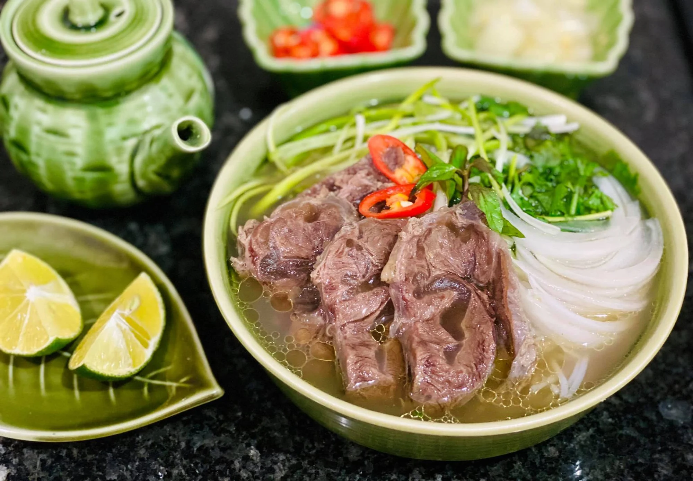

# WebDevClassNote01
## Phở Recipe
**VERY IMPORTANT: Do not mistake this with Pad Thai**
### *Ingredients*
- Rice vermicelli
- Beef
- Ginger
- Cinnamon
- Cardamon
- Coriander
- Star Anise
- Fish sauce
- Meaty bone

### *Instruction*
1. Quick boil – Remove impurities from beef with a 5 minute boil, it’s the path to a beautiful clear soup
2. Scum – be amazed at all the icky stuff that comes out;
3. Wash the bones to get all the icky scum off;
4. Simmer for 3 hours – bones, beef, water, onion, ginger and spices (cinnamon, cardamom, coriander, star anise);
5. Remove brisket  – some is used for Pho topping, then I reserve the remainder for Caramelised Vietnamese Pulled Beef which I created especially;
6. Simmer 40 minutes further with just bones;
7. Strain; then
8. Ladle into bowls over noodles and pile on Toppings!

*[You can follow the orginal instruction here](https://www.recipetineats.com/vietnamese-pho-recipe/)*